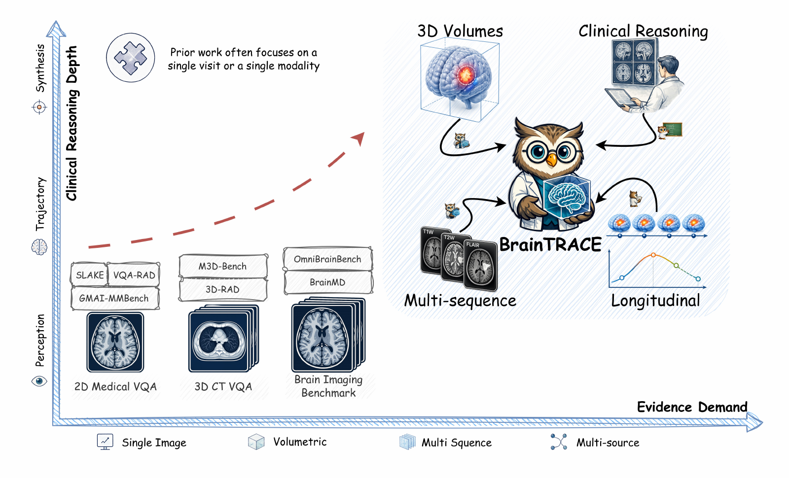
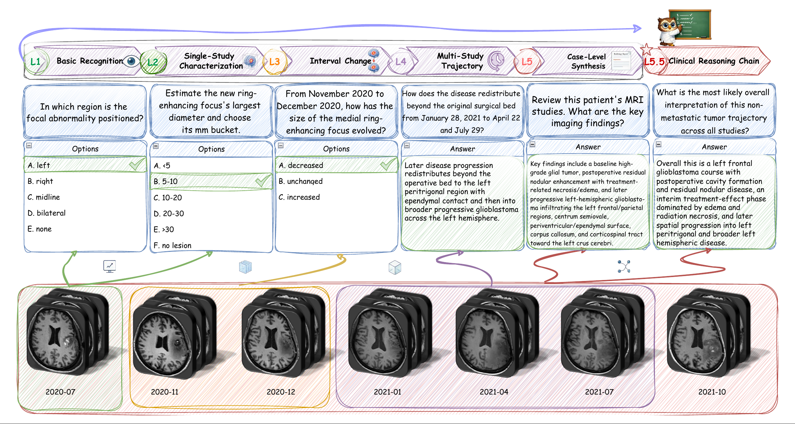
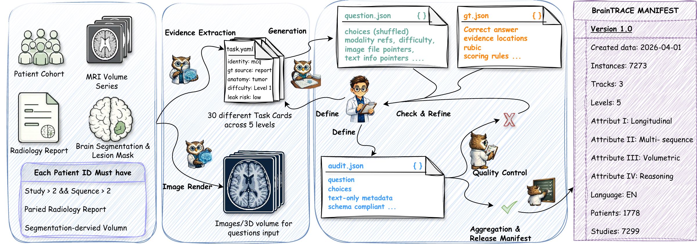
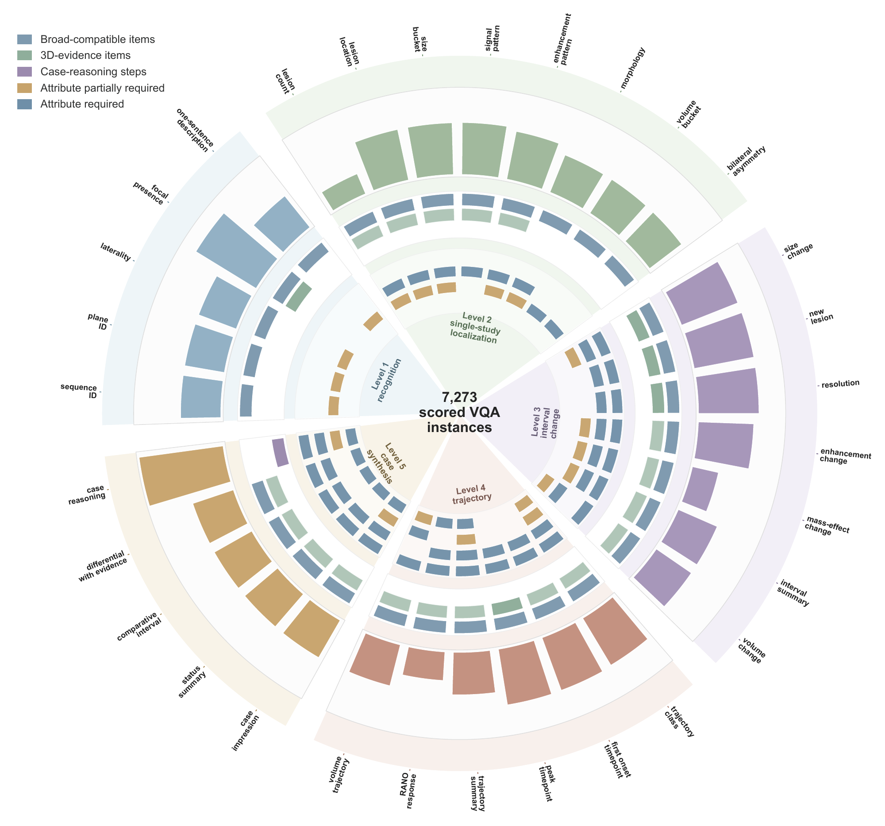
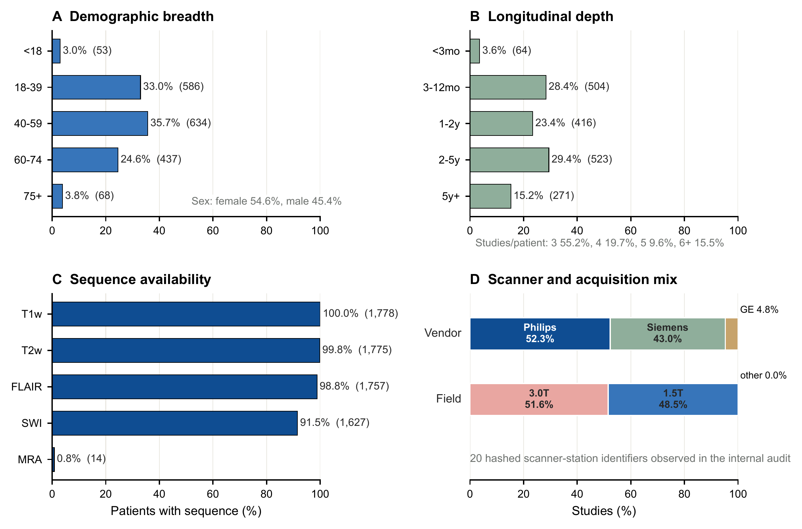
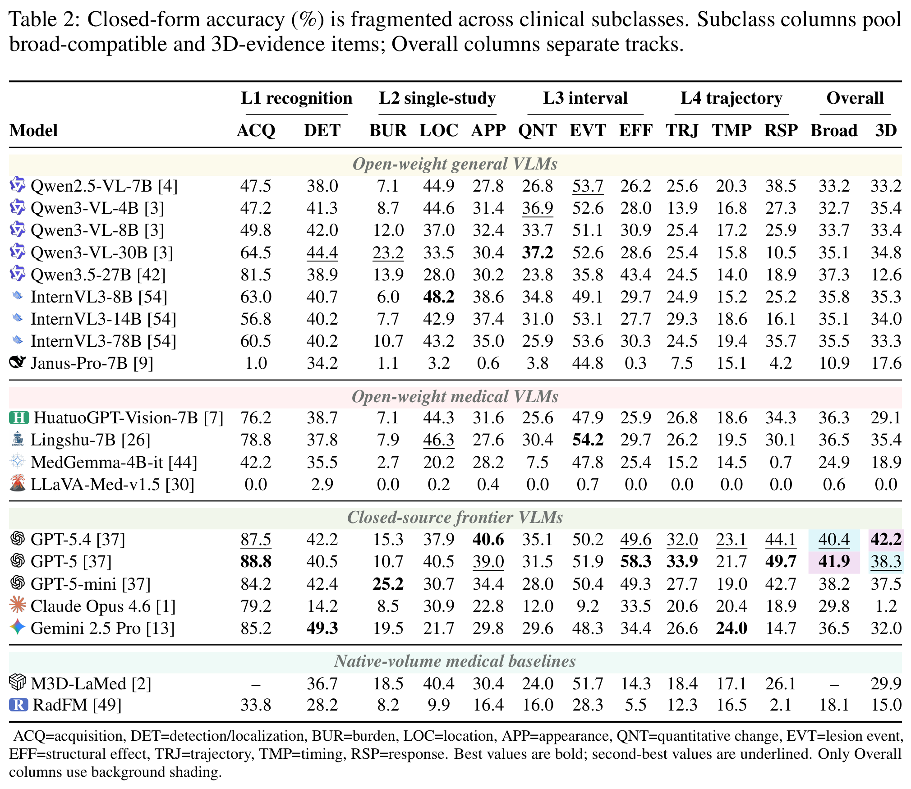
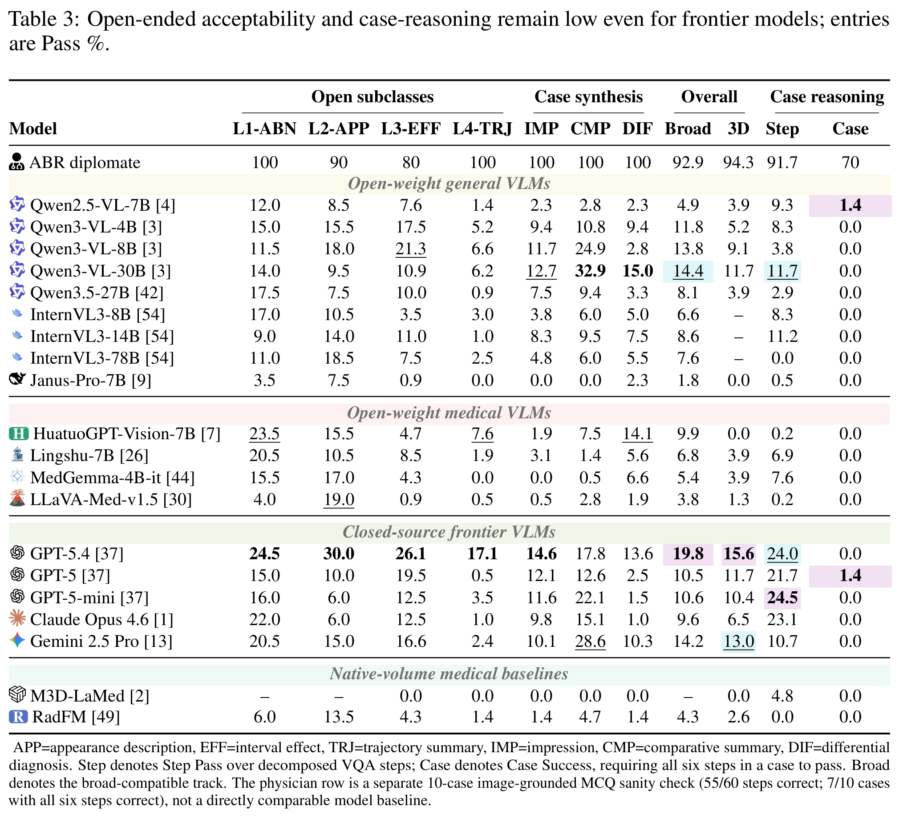
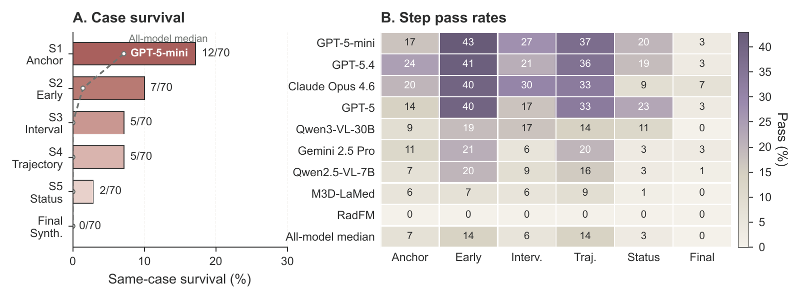

<h1 align="center">BrainTRACE</h1>

<p align="center"><strong>Tracing Longitudinal, Multimodal, and Volumetric Evidence<br>in Brain MRI Clinical Reasoning</strong></p>

<p align="center">
  <a href="https://openreview.net/forum?id=hXktXOmwp6"></a>
  <a href="https://huggingface.co/datasets/BrainTRACE-anon/BrainTRACE"></a>
  <a href="./LICENSE"></a>
</p>

<p align="center">
  Qizhen Lan<sup>*</sup> · Mengchen Fan<sup>*</sup> · Hang Zhang<sup>*</sup> · Jingwei Duan<br>
  Moule Lin · Jialin Chen · Baocheng Geng · Xiaoqian Jiang<sup>†</sup><br>
  <sub><sup>*</sup>Equal contribution · <sup>†</sup>Corresponding author: Xiaoqian Jiang<br>
  Contact: <a href="mailto:qizhen.lan@uth.tmc.edu">qizhen.lan@uth.tmc.edu</a></sub>
</p>

<p align="center">
  <a href="https://openreview.net/forum?id=hXktXOmwp6">Paper / OpenReview</a> ·
  <a href="https://huggingface.co/datasets/BrainTRACE-anon/BrainTRACE">Dataset</a> ·
  <a href="#key-results">Results</a> · <a href="#get-started">Get started</a> · <a href="#citation">Citation</a>
</p>

**Accepted at NeurIPS 2026, Evaluations & Datasets Track (Poster).**

BrainTRACE benchmarks longitudinal, multimodal, and volumetric reasoning over brain MRI.



| Scored VQA instances | Longitudinal patients | MRI studies | Model configurations |
|:---:|:---:|:---:|:---:|
| **7,273** | **1,778** | **7,299** | **20** |

## Benchmark design

<p align="center">
  <a href="docs/assets/case-reasoning-example.png"></a><br>
  <sub>Figure 2 · Longitudinal case and task examples</sub>
</p>

<p align="center">
  <a href="docs/assets/benchmark-construction.png"></a><br>
  <sub>Figure 3 · Benchmark construction</sub>
</p>

## Benchmark coverage

<p align="center">
  <a href="docs/assets/benchmark-coverage.png"></a>
  <a href="docs/assets/cohort-diversity.png"></a>
</p>

## Key results

<p align="center">
  <a href="docs/assets/closed-form-results.png"></a>
  <a href="docs/assets/open-case-results.png"></a>
</p>

<p align="center">
  <a href="docs/assets/case-reasoning-attrition.png"></a>
</p>

[Full metrics and scoring details →](docs/RESULTS.md)

## Get started

Download the [benchmark metadata](https://huggingface.co/datasets/BrainTRACE-anon/BrainTRACE) and obtain [MR-RATE](https://huggingface.co/datasets/Forithmus/MR-RATE) under its Data Use Agreement. MRI imagery is not redistributed.

<details>
<summary><strong>Quickstart commands</strong></summary>

### 1. Install and download metadata

```bash
git clone https://github.com/lanqz7766/BrainTRACE.git
cd BrainTRACE
python -m venv .venv
source .venv/bin/activate
python -m pip install -r requirements.txt

python -c "from huggingface_hub import snapshot_download; snapshot_download('BrainTRACE-anon/BrainTRACE', repo_type='dataset', local_dir='./braintrace_dataset')"
```

### 2. Render MR-RATE inputs

Place MR-RATE under `./mr_rate` using the layout in the [rendering guide](reproduction/README.md).

```bash
python reproduction/render_images.py \
  --dataset ./braintrace_dataset \
  --mr-rate-root ./mr_rate \
  --out-root ./braintrace_dataset
```

### 3. Run a VLM

Set `OPENAI_API_KEY` in your shell for this OpenAI example and the default scoring judge.

```bash
python eval/vlm_eval_api.py \
  --model gpt-5.4 \
  --provider openai \
  --sample-file ./braintrace_dataset/data/test.parquet \
  --images-root ./braintrace_dataset/images \
  --out-dir ./outputs/gpt-5.4/main_outputs \
  --reasoning-effort medium \
  --max-tokens 2048 \
  --parallel 4 \
  --skip-existing
```

See the [inference guide](eval/README.md) for other APIs, case reasoning, and prediction formats. Open-weight and native-volume models require separate backends.

### 4. Score predictions

```bash
python scoring/score.py \
  --dataset ./braintrace_dataset \
  --predictions ./outputs/gpt-5.4/main_outputs \
  --out-dir ./scores/gpt-5.4 \
  --judge-model gpt-4o-mini-2024-07-18
```

Outputs include `summary.json` and judge audit records. Add `--mode closed` to score closed-form items without judge calls; use the case output directory for case-reasoning predictions. Paper comparisons require the recorded inputs and model/judge settings in the [run manifest](reproduction/leaderboard_runs.csv).

</details>

**Documentation:** [Rendering](reproduction/README.md) · [Inference](eval/README.md) · [Scoring](scoring/README.md) · [Rubrics](docs/SCORING.md) · [Taxonomy](docs/TAXONOMY.md) · [Full results](docs/RESULTS.md) · [Run manifest](reproduction/leaderboard_runs.csv)

## Citation

```bibtex
@inproceedings{lan2026braintrace,
  title     = {BrainTRACE: Tracing Longitudinal, Multimodal, and Volumetric Evidence in Brain MRI Clinical Reasoning},
  author    = {Lan, Qizhen and Fan, Mengchen and Zhang, Hang and Duan, Jingwei and Lin, Moule and Chen, Jialin and Geng, Baocheng and Jiang, Xiaoqian},
  booktitle = {Advances in Neural Information Processing Systems},
  year      = {2026},
  note      = {Evaluations and Datasets Track},
  url       = {https://openreview.net/forum?id=hXktXOmwp6}
}
```

## License and contact

- **Code:** [Apache-2.0](LICENSE).
- **Benchmark metadata and task definitions:** CC-BY-NC-SA 4.0, as specified on the dataset card.
- **MR-RATE source imagery, reports, and imagery derivatives:** upstream access conditions and Data Use Agreement; see [DUA_NOTICE.md](DUA_NOTICE.md).

For bugs or clarification requests, open a [GitHub issue](https://github.com/lanqz7766/BrainTRACE/issues). Research enquiries: [qizhen.lan@uth.tmc.edu](mailto:qizhen.lan@uth.tmc.edu).
